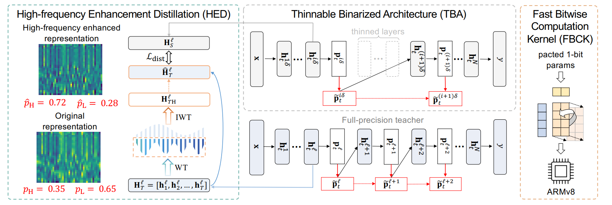

# BiFSMN: Binary Neural Network for Keyword Spotting

**IJCAI 2022 · pages 4346–4352**

Haotong Qin, Xudong Ma, Yifu Ding, Xiaoyang Li, Yang Zhang, Yao Tian, Zejun Ma, Jie Luo, Xianglong Liu

[Published paper](https://www.ijcai.org/proceedings/2022/603) | [PDF](https://www.ijcai.org/proceedings/2022/0603.pdf) | [Citation](#citation)

**BiFSMN is a binary keyword-spotting network combining High-frequency Enhancement Distillation (HED), a Thinnable Binarization Architecture (TBA), and an ARMv8 Fast Bitwise Computation Kernel (FBCK).** It targets always-on speech recognition under edge-device compute and storage constraints.

## Published results and scope

Speech Commands classification accuracy (%) on the 12-class task. W/A denotes weights/activations in the binary network; sensitive full-precision operations are retained. The full, half, and quarter settings refer to the paper's thinnable architecture, not to weight bit-width.

| Method / runtime setting | W/A | V1-12 accuracy | V2-12 accuracy |
| --- | --- | --- | --- |
| Full-precision reference | 32/32 | 97.93 | 98.05 |
| BiFSMN, full | 1/1 | 95.03 | 94.86 |
| BiFSMN, half | 1/1 | 94.87 | 94.73 |
| BiFSMN, quarter | 1/1 | 94.48 | 94.63 |

Source: Table 2. The full BiFSMN is 2.90 percentage points below the full-precision V1-12 reference. Figure 5 reports 34.7/22.9/16.9 ms for full/half/quarter with the proposed kernel, versus 377 ms for full precision. The reported **22.3× maximum speedup** applies to the **quarter** variant; the full model achieves approximately 10.9×. The **15.5× storage saving** is a parameter-storage ratio, not runtime memory reduction.

### What this paper supports

- HED emphasizes high-frequency teacher features during binarization-aware training (Section 3; Table 1).
- TBA supports runtime accuracy/efficiency trade-offs without independently training every depth (Section 3; Tables 1–2).
- On V1-12, full BiFSMN reaches 95.03% versus 86.81% for the IR-Net binarization baseline in this speech experiment (Table 2).
- The approach is evaluated across 12-, 20-, and 35-class Speech Commands tasks and multiple architectures (Tables 2–3).
- FBCK improves actual ARMv8 inference latency; theoretical FLOPs alone do not explain the deployment result (Section 4.3; Figure 5).

The deployment experiment uses Raspberry Pi 3B+ with a 1.2 GHz ARMv8 Cortex-A53 CPU as described in the paper. These results depend on the optimized binary kernel and do not imply the same speedup on GPU/PyTorch. Training uses speech data and a full-precision teacher; it is not data-free PTQ. The tables above are paper results, not newly reproduced measurements.

Created by [Haotong Qin](https://htqin.github.io/), Xudong Ma, [Yifu Ding](https://yifu-ding.github.io/), Xiaoyang Li, Yang Zhang, Yao Tian, Zejun Ma, Jie Luo, and [Xianglong Liu](https://xlliu-beihang.github.io/) from Beihang University and Bytedance AI Lab.



Related work: [BiFSMNv2](https://github.com/htqin/BiFSMNv2) is the later journal extension with dual-scale architecture, FID, and LPB.

## Datasets and Pretrained Models

We train and test BiFSMN on Google Speech Commands V1 and V2 datasets, which can be downloaded in the reference document:

- https://pytorch.org/audio/stable/_modules/torchaudio/datasets/speechcommands.html#SPEECHCOMMANDS

Distillation requires a full-precision teacher checkpoint for the matching Speech Commands task.

## Execution

Set `teacher_model_checkpoint_path` to your local full-precision teacher checkpoint before running. This README currently has no downloadable teacher-checkpoint link. The reference training command is:

```shell
python3 train_speech_commands.py \
    --gpu=0 \
    --model=BiDfsmn_thinnable --dfsmn_with_bn \
    --method=Vanilla \
    --distill \
    --distill_alpha=0.01 \
    --select_pass=high \
    --J=1 \
    --pretrained \
    --teacher_model=BiDfsmn_thinnable_pre \
    --teacher_model_checkpoint=${teacher_model_checkpoint_path} \
    --version=speech_commands_v0.01 \
    --num_classes=12 \
    --lr-scheduler=cosin \
    --opt=sgd \
    --lr=5e-3 \
    --weight-decay=1e-4 \
    --epoch=300

```

## Citation

Please cite the published paper below. Open paper versions are linked at the top of this README.

```bibtex
@inproceedings{qin2022bifsmn,
  title = {BiFSMN: Binary Neural Network for Keyword Spotting},
  author = {Haotong Qin and Xudong Ma and Yifu Ding and Xiaoyang Li and Yang Zhang and Yao Tian and Zejun Ma and Jie Luo and Xianglong Liu},
  booktitle = {Proceedings of the Thirty-First International Joint Conference on Artificial Intelligence},
  year = {2022},
  pages = {4346--4352},
  doi = {10.24963/ijcai.2022/603},
  url = {https://www.ijcai.org/proceedings/2022/603}
}
```
